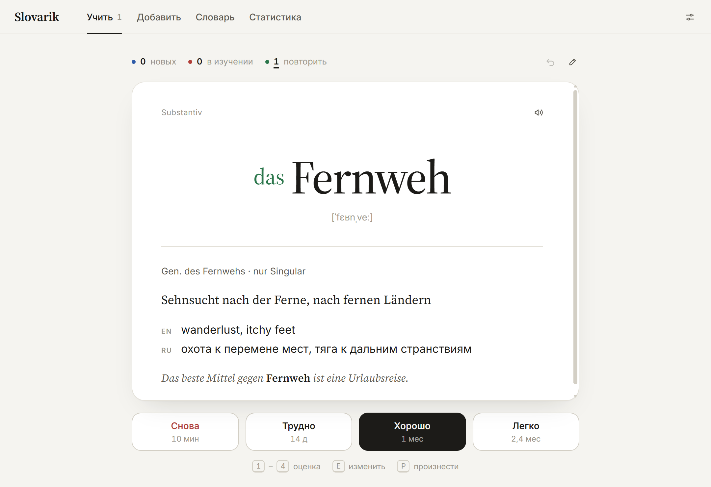
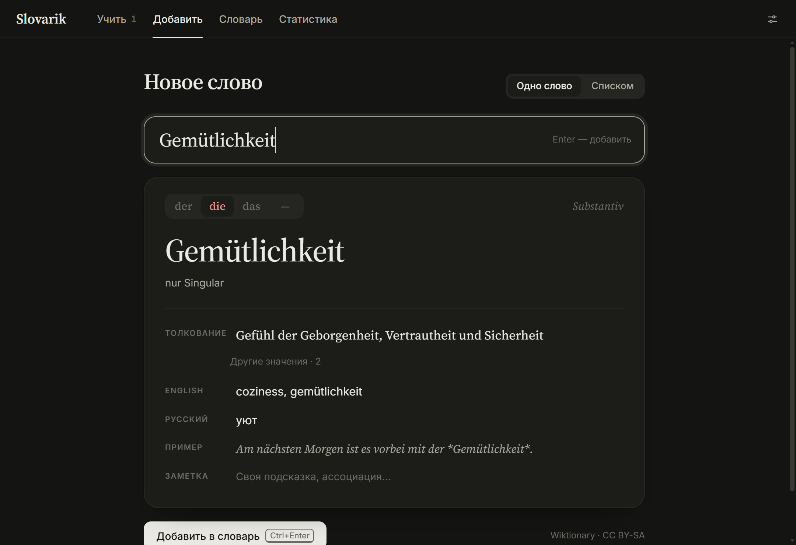

# Slovarik (Wortschätzli)

Карточки для немецких слов в духе Anki. Вводишь слово — Slovarik сам подставляет толкование на немецком, артикль, формы, пример и перевод на английский и русский. Повторения планирует FSRS — тот же алгоритм, что в современной Anki.



## Установка

**macOS** — через Homebrew:

```bash
brew tap NellleT/slovarik https://github.com/NellleT/Slovarik
brew install --cask slovarik
```

**Windows** — скачай `Slovarik_*_x64-setup.exe` со страницы [релизов](https://github.com/NellleT/Slovarik/releases/latest) или поставь через [Scoop](https://scoop.sh) (Homebrew на Windows не работает):

```bash
scoop bucket add slovarik https://github.com/NellleT/Slovarik
scoop install slovarik
```

Обновление — `brew upgrade --cask slovarik` или `scoop update slovarik`.

> Приложение не подписано платным сертификатом Apple, поэтому Homebrew после установки снимает с него флаг карантина, чтобы macOS разрешила его открыть.

## Как это работает

- **Добавление.** Пишешь слово, при желании с артиклем («die Bank») или «sich». Данные берутся из немецкого [Wiktionary](https://de.wiktionary.org); если перевода там нет, подставляется перевод MyMemory. Всё можно поправить перед сохранением. Формы сводятся к словарной: «Häuser» → *das Haus*, «lief» → *laufen*. Можно вставить сразу столбик слов.
- **Повторение.** Карточка показывает слово, по пробелу открывается ответ. Оцениваешь, насколько легко вспомнил: «Снова», «Трудно», «Хорошо» или «Легко» (клавиши 1–4). По этой оценке FSRS решает, когда показать слово снова: через минуты, дни или месяцы.
- **Род по цвету:** *der* — синий, *die* — красный, *das* — зелёный. Артикль можно прятать, чтобы вспоминать его самому.
- **Обратные карточки** (русский → немецкий), произношение системным голосом, статистика, светлая и тёмная тема.
- **Язык интерфейса** — русский, English или Deutsch (в настройках).
- **Данные** хранятся только на твоём компьютере, в одном файле `slovarik.json`; рядом лежит ежедневная резервная копия. Есть экспорт и импорт JSON и CSV.



## Сборка из исходников

Нужны Node.js 20+ и [Rust](https://rustup.rs).

```bash
npm install
npm run tauri dev     # запустить
npm test              # тесты
npm run tauri build   # установщик
```

Новая версия: `npm version 0.2.0 && git push --follow-tags`. GitHub Actions соберёт приложения для macOS и Windows, опубликует релиз и обновит формулы Homebrew и Scoop.

Код распространяется по лицензии MIT, данные Wiktionary — по CC BY-SA 4.0.
